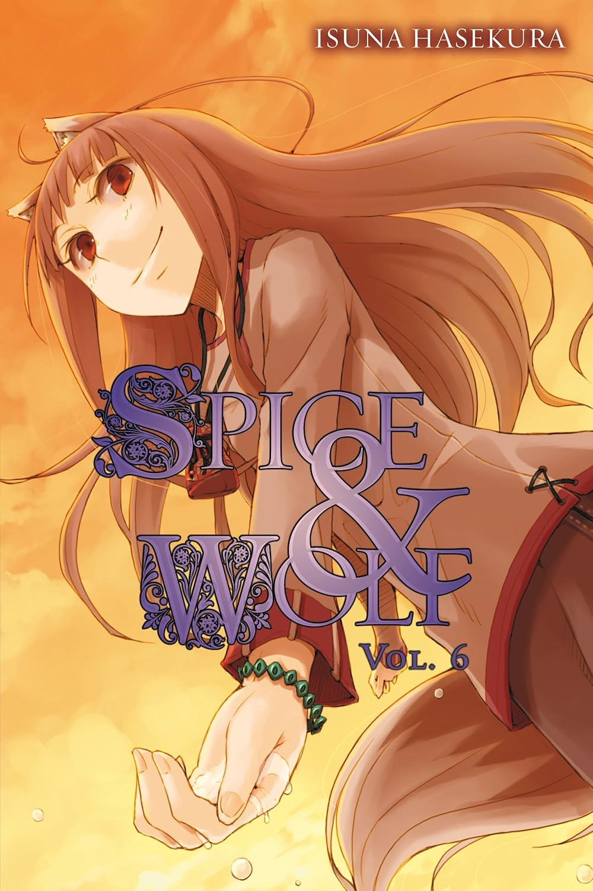

# Spice and Wolf, Volume 6

## Cover

## Synopsis

> "You won't go quarreling with your companion over anything quite that foolish again, will you now?"

Holo is still agitated at Lawrence, partly out of frustration with him for letting his deal with Eve fall through. Though this is partly due to it cutting off her chance to part cleanly with him, it's also because of his confession at the end of the previous volume. For his part, with Holo back and only a moderate loss to show for it, Lawrence is perfectly willing to cut his losses and walk away. Not only that, but as he technically backed out of the deal, he doesn't feel he has any right to a share of the profits anyway.

Though initially unsure of what they should do next, Holo is unwilling to let bygones be bygones, and pressures Lawrence into agreeing to pursue Eve. However, as traveling by wagon would be too slow and tiresome, the duo instead catch a ship down the Roam River to Kerube, where Lawrence assumes Eve is planning to sell the furs.

Traveling down the river, Lawrence and Holo's boat stops at a tariff checkpoint--the first of many along the river. Here they see a boy arguing with the guards over a forged certificate. The commotion is holding up river traffic, however, so the guards prepare to use force against the boy. In one last desperate ploy, he runs towards Lawrence and pretends to be his apprentice. Neither Lawrence nor the guards are fooled by this, but Holo is sympathetic and forces Lawrence to play along with it.

As the three continue down the river, the boy is initially hesitant to open up to Lawrence and Holo, but eventually introduces himself as Tate Col, a former student from the distant town of Aquent. Col had been studying church law in Aquent, but ran out of money for his tuition. He was forced to flee the town, and was later swindled into buying a book full of stolen trade memos and certificates. With some pressure from Holo, Lawrence decides to give Col some tutoring in how to avoid such scams in the future, and handle his money better. He also opts to buy Bol's book from him, seeing some personal value in the information that a stack of trade memos could provide.

Col's book turns out to contain several trade memos from a certain Jean Company, which was handling importation of newly minted copper currency for the small kingdom of Winfiel (which also happens to be Eve's birthplace). Looking through the memos, Lawrence notices a discrepancy, in that the company would order 57 chests of coins from copper suppliers, but ultimately deliver 60 chests to Winfiel. This leads him to wonder if the Jean Company may have dabbled in illegal coin minting.

The combination of Col's tutelage and the Jean Company issue taking up Lawrence's attention quickly begins to grate on Holo. Noticing this and knowing how clever Holo is, Lawrence attempts to enlist her help in figuring out what's going on with the Jean Company, hoping she would find it as mentally engaging as he does. Instead, Holo gets angry and decides to stop speaking to him until he can figure out why.

As the trio's boat continues its journey down the river, it eventually encounters a severe traffic jam, caused by a boat that has run aground up ahead. Lawrence guesses Even had something to do with it. With the river blocked for the time being, their boat driver, Ragusa, asks them to walk the rest of the way, but as an apology, offers to at least let Holo continue riding until he reaches said obstruction. Still dumbfounded by Holo's earlier reaction, Lawrence is fine with this arrangement. Before they leave, Ragusa pulls Lawrence aside and, revealing that some of the cargo on his ship consists of copper coins for the Jean Company, asks if Lawrence intends to anything with his suspicions about them. Lawrence assures Ragusa that he was only puzzling things out for fun.

While he and Col walk, Lawrence asks Col more about his past. Col explains that his hometown is a small northern village called Pinu, located near the Roef Mountains. When missionaries from the church arrived to reform the region, Col set out to become a church scholar, hoping to protect his village from within their ranks.

Lawrence and Col arrive at the scene of the jam and find that there is indeed a sunken ship completely blocking the river. Everyone is frustrated, but, unable to dislodge it, they eventually give up, and hold a makeshift festival to improve the mood. As the atmosphere turns to merriment, Holo decides to let up on Lawrence a little, and the two sit together watching the festivities. Lawrence finally realizes what made her so angry. He'd come to assume that Holo, being as intelligent as she is, enjoyed solving puzzles, and so it made sense to ask for her help. Holo, however, saw it as her being taken for granted. Every problem she'd helped him overcome, she had done so primarily for his sake, not simply for the fun of it.

After reconciling, Holo leaves to dance with the others, while Lawrence, feeling a bit frustrated with what he considers to be a bit of unreasonableness on Holo's part, starts drinking with Ragusa and the other boatmen. They have a drunken conversation about the Jean Company, where Ragusa mentions a strange phenomenon where a company upriver would repeatedly send copper coin shipments down to Kerube, despite them being consistently refused upon delivery. Lawrence wonders if it has anything to do with currency fluctuations, before passing out.

Lawrence and Holo later wake up in the middle of the night. The two stroll through the camp together and chat idly, before going to find Col. Holo asks Col if his village has any legends of superstitions. He tells them the story of a frog god who supposedly saved Pinu from ruination, but Holo is decidedly unimpressed and asks if there are any tales involving wolves. To this, Col replies that in another village in the same region, called Rupi, it's said that the ancestor of Rupi's villagers was a wolf. Though those gods are dead now, it's said that before passing away, the wolf god left behind its offspring and its left foreleg, which protected the region from sickness.

Just then, the sunken ship--having finally been dislodged by the current and repeated attempts to move it--begins to give way, but another ship is about to be swept down the river as a result. This would cause the same blockage to happen all over again, so the boatmen rush to prevent it. Amidst this, Holo and Lawrence realize that the real reason why the Church visited Col's region wasn't simply to convert the villagers, but to retrieve and ultimately destroy the wolf bones. Destroying such an artifact would prove that it was in fact nothing special, and that the Church's beliefs are superior.

Unwilling to let this happen, Holo resolves to retrieve the bones for herself. She does not ask Lawrence to accompany her in this, and Lawrence recognizes that it would involve crossing the Church and thus would certainly be perilous. However, it's also a fine opportunity for the two to extend their journey, so Lawrence is happy to come with her.

With a new goal in mind, Lawrence and Holo revise their travel plans. After all these delays, going by boat would no longer get them to Kerube quickly enough to catch Eve, so they decide to use Holo's wolf form and run the rest of the way. Knowing that Even likely has extensive knowledge of the region and its happenings, they decide to find her and, as Holo puts it, strongarm her into giving them information. Though Lawrence is not opposed to bringing Col--both he and Holo have grown fond of him--he decides to only allow it if Col himself asks to come along. He doesn't, so Lawrence and Holo depart.

However, just aas Holo is about to transform, Col catches up with them and asks if he can come after all. To demonstrate his determination, he shows Lawrence a copper coin, presumably stolen from Ragusa's cargo (signifying that he wouldn't be able to go back even if they turned him down). Lawrence accepts, and Holo shows Col her wolf form. To Lawrence's surprise and Holo's delight, Col is ecstatic, rather than shocked or terrified.

Before getting underway, Col adds that he figured out why the copper coins didn't add up, which startles Lawrence. He also admits that he didn't actually steal the coin he showed Lawrence. Rather, after Col changed his mine, Ragusa gave him the coin out of his own purse, partly for luck and partly to sell such an act to Lawrence. As they ride on Holo's back, Lawrence asks Col why the coins didn't add up. Here however, Holo interjects, stating that Lawrence ought to figure it out himself, since he enjoys puzzling such things out so much.

